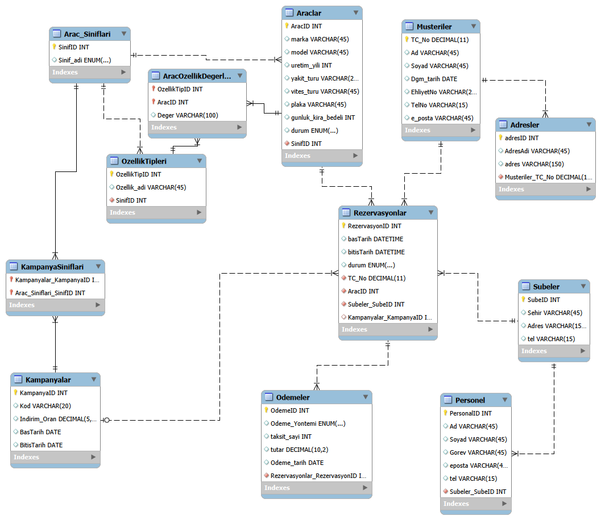

# Araç Kiralama Şirketi – İlişkisel Veritabanı Modeli

Bir araç kiralama şirketinin operasyonlarını (araçlar, müşteriler, rezervasyonlar, ödemeler, kampanyalar, şubeler ve personel) yönetmek için tasarlanmış MySQL veritabanı modeli. Veritabanı Yönetim Sistemleri dersi ödevi olarak **MySQL Workbench** ile hazırlanmıştır.

## ER Diyagramı



## Dosyalar

| Dosya | Açıklama |
|---|---|
| `AracKiralama_DDL.sql` | Şema, tablolar (CREATE TABLE), CHECK kısıtları ve trigger'lar |
| `AracKiralama_EER.png` | Modelin EER diyagramı |
| `AracKiralama.mwb` | MySQL Workbench model dosyası |

## Tablolar

| Tablo | Amaç |
|---|---|
| `Arac_Siniflari` | Araç sınıfları (ekonomik, SUV, lüks, ticari) |
| `Araclar` | Marka, model, yıl, yakıt/vites türü, plaka, günlük kira bedeli, durum |
| `OzellikTipleri` | Sınıfa özgü özellik tanımları (örn. çekiş tipi, deri koltuk) |
| `AracOzellikDegerleri` | Araç – özellik tipi değerleri (N:M ara tablo) |
| `Musteriler` | TC no, ad, soyad, doğum tarihi, ehliyet no, telefon, e-posta |
| `Adresler` | Müşterinin birden fazla adresi (ev, iş, yazlık vb.) |
| `Subeler` | Farklı şehirlerdeki şubeler |
| `Personel` | Şubelerde çalışan personel |
| `Kampanyalar` | İndirim kuponları ve geçerlilik tarihleri |
| `KampanyaSiniflari` | Kuponun hangi araç sınıflarında geçerli olduğu (N:M ara tablo) |
| `Rezervasyonlar` | Müşteri, araç, şube, tarih aralığı, durum, (opsiyonel) kampanya |
| `Odemeler` | Ödeme yöntemi, taksit sayısı, tutar, tarih |

## Temel İlişkiler

- `Arac_Siniflari` 1 – N `Araclar`
- `Arac_Siniflari` 1 – N `OzellikTipleri`
- `Araclar` N – M `OzellikTipleri` (`AracOzellikDegerleri`, değer sütunuyla)
- `Musteriler` 1 – N `Adresler`
- `Musteriler` 1 – N `Rezervasyonlar`
- `Araclar` 1 – N `Rezervasyonlar`
- `Subeler` 1 – N `Rezervasyonlar`
- `Subeler` 1 – N `Personel`
- `Kampanyalar` 1 – N `Rezervasyonlar` (opsiyonel, NULL olabilir)
- `Kampanyalar` N – M `Arac_Siniflari` (`KampanyaSiniflari`)
- `Rezervasyonlar` 1 – N `Odemeler`

## İş Kuralları

- **Çakışan rezervasyon engeli:** Aynı araç, aynı tarih aralığında birden fazla (iptal edilmemiş) rezervasyona atanamaz. Farklı tarihlerde tekrar kiralanabilir. (`Rez_Cakisma` ve `Rez_Cakisma_UPDATE` trigger'ları)
- **Kupon kontrolü:** Kupon, rezervasyon başlangıç tarihinde geçerli olmalı ve aracın sınıfında kullanılabilmelidir. (aynı trigger'lar)
- **Tarih kısıtları (CHECK):** Rezervasyon bitişi başlangıçtan sonra olmalı; kampanya bitişi başlangıçtan önce olamaz.
- **Benzersiz kupon kodu:** `Kampanyalar.Kod` UNIQUE.
- **Durum alanları:** ENUM ile sınırlandırılmıştır
  - Araç: `musait`, `kirada`, `bakimda`
  - Rezervasyon: `onaylandi`, `iptal edildi`, `tamamlandi`
  - Ödeme yöntemi: `kredi karti`, `havale`, `nakit`

## Kurulum

Gereksinimler: **MySQL 8.0.16 veya üzeri** (CHECK kısıtlarının uygulanması için) ve MySQL Workbench.

1. MySQL Workbench'te sunucuya bağlan.
2. `File → Open SQL Script...` ile `AracKiralama_DDL.sql` dosyasını aç.
3. Tüm scripti seç (`Ctrl+A`) ve çalıştır (`Ctrl+Shift+Enter`).
4. `mydb` şeması altında 12 tablo ve `Rezervasyonlar` üzerinde 2 trigger oluşur.

> Not: Script, `mydb` şemasındaki aynı adlı tabloları `DROP TABLE IF EXISTS` ile silip yeniden oluşturur.

## Hızlı Test

Önce bir şube, sınıf, araç ve müşteri ekle, ardından çakışan rezervasyonu dene:

```sql
USE mydb;

INSERT INTO Subeler (Sehir, Adres, tel) VALUES ('Istanbul', 'Kadikoy', '02161112233');
INSERT INTO Arac_Siniflari (Sinif_adi) VALUES ('ekonomik');
INSERT INTO Araclar (marka, model, uretim_yili, yakit_turu, vites_turu, plaka, gunluk_kira_bedeli, durum, SinifID)
VALUES ('Fiat', 'Egea', 2022, 'dizel', 'manuel', '34ABC123', 1500, 'musait', 1);
INSERT INTO Musteriler (TC_No, Ad, Soyad) VALUES (11111111111, 'Ali', 'Yilmaz');

INSERT INTO Rezervasyonlar (basTarih, bitisTarih, durum, TC_No, AracID, Subeler_SubeID)
VALUES ('2026-11-01', '2026-11-05', 'onaylandi', 11111111111, 1, 1);

-- Hata vermeli: "Bu arac secilen tarihlerde zaten rezerve."
INSERT INTO Rezervasyonlar (basTarih, bitisTarih, durum, TC_No, AracID, Subeler_SubeID)
VALUES ('2026-11-03', '2026-11-07', 'onaylandi', 11111111111, 1, 1);
```

## Kullanılan Araçlar

- MySQL 8.0
- MySQL Workbench 8.0
